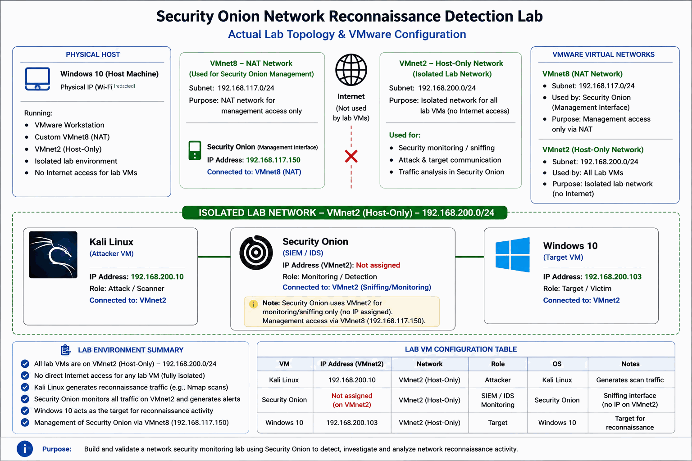

# Project 1 — Security Onion Network Reconnaissance Detection Lab

This project documents an authorized TCP SYN reconnaissance exercise in an isolated VMware home lab. Nmap traffic was generated from Kali Linux against a Windows 10 virtual machine, then investigated using Security Onion/Suricata alerts and packet-level observations.

**Investigation workflow:** Generate activity → Detect → Investigate → Correlate → Validate → Document.

> **Scope:** Lab-only activity against a Windows virtual machine controlled by the author. The evidence collected for this exercise did not demonstrate successful compromise.

## Investigation at a glance

| Item | Recorded value |
|---|---|
| Date | 24 August 2026 |
| Scan time | Approximately 16:37 WAT |
| Source | Kali Linux — `192.168.200.10` |
| Target | Windows 10 — `192.168.200.103` |
| Monitoring | Security Onion with Suricata |
| Scan command | `sudo nmap -sS -Pn 192.168.200.103` |
| Nmap result | Target up; `5357/tcp` open (`wsdapi`); 999 TCP ports filtered/no response |
| Packet evidence | Security Onion PCAP Job `1002` |
| ATT&CK mapping | T1046 — Network Service Scanning |

## Lab topology

The corrected topology uses two VMware virtual networks:

- **VMnet8 (NAT):** Management subnet `192.168.117.0/24`; Security Onion management address `192.168.117.150`.
- **VMnet2 (Host-only):** Isolated lab subnet `192.168.200.0/24`.
- **Kali Linux:** `192.168.200.10`, used to initiate the scan.
- **Windows 10 target:** `192.168.200.103`.
- **Security Onion monitoring interface:** Connected to VMnet2 without an IP assigned to the sniffing interface; management access uses VMnet8.

## Key findings

- Nmap reported the target up, with `5357/tcp` open (`wsdapi`) and 999 TCP ports filtered/no response.
- The investigation notes recorded multiple ET SCAN detections associated with common service ports, including MSSQL (`1433`), Oracle SQL (`1521`), PostgreSQL (`5432`), MySQL (`3306`), and a VNC range (`5800–5820`).
- The supplied PCAP view showed repeated TCP SYN probes from `192.168.200.10` to `192.168.200.103`.
- The source and destination addresses, timing, alert information, packet observations, and Nmap output were consistent with the authorized scan.
- No evidence collected in this exercise demonstrated successful compromise, payload delivery, or lateral movement.

A detection signature match does not prove that the named service was available or compromised. The report distinguishes alert telemetry, packet observations, and Nmap results as separate evidence sources.

## Investigation report and supporting evidence

- **[Read the detailed SOC case study](case-study.md)** — lab setup, Nmap results, Suricata findings, packet-level review, evidence correlation, analyst assessment, ATT&CK mapping, lessons learned, and scope limitations.
- **[Open the evidence directory](evidence/)** — project artifacts and the evidence index.
- **[Read the evidence index](evidence/README.md)** — identifies each artifact and its role in the investigation.
- **[View the Security Onion PCAP Job 1002 packet view](evidence/06-security-onion-pcap-job-1002-packet-view.png)**.

## Skills demonstrated

Network monitoring · Suricata alert triage · Security Onion investigation · PCAP review · Nmap validation · Evidence correlation · MITRE ATT&CK mapping · SOC investigation documentation

## Scope and limitations

This was an educational home-lab exercise, not a production security assessment. Findings are limited to the recorded scan and the artifacts described in the case study. No raw PCAP is published in this repository. The material documents reconnaissance detection and investigation; it does not claim a successful compromise or comprehensive detection coverage.

## Author

**Taiwo H Ibrahim**  
Cybersecurity | Security Operations | Network Security
